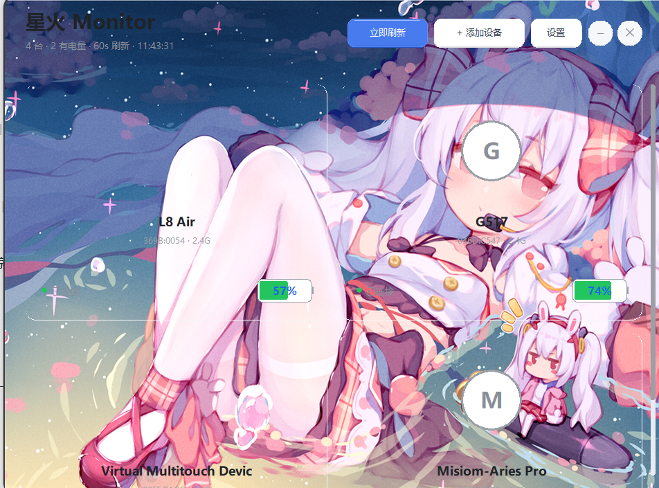
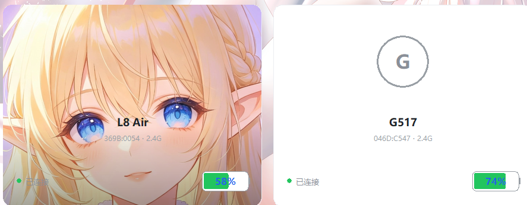
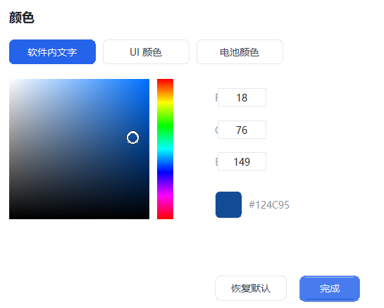
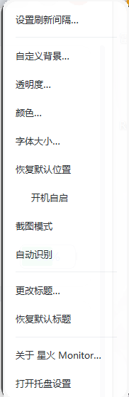
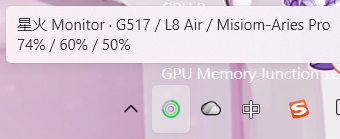
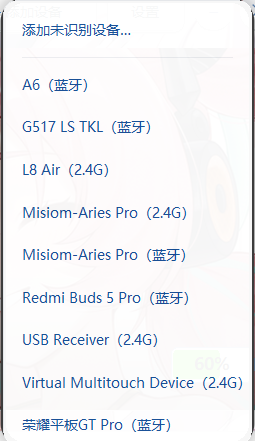

> # 星火 Monitor · Spark Monitor

基于EZ2.4G项目，把 **2.4GHz 无线设备**和**蓝牙设备**的电量，常驻在 Windows 系统托盘里。

但它不只是个电量工具——**你看到的每一处，都可以换成你自己的样子**。

[](LICENSE.md)


<p align="center">
  
</p>

> 上图就是默认之外的样子：整窗换成插画背景、每张卡片各自一张图、电量徽章换成紫/绿主题色。

---

## 目录

- [这是什么](#这是什么)
- [核心特色：完全自定义](#核心特色完全自定义)
  - [软件背景](#1-软件背景换成一整张插画)
  - [卡片背景](#2-卡片背景一台设备一张图)
  - [透明度](#3-透明度0-100-实时预览)
  - [颜色](#4-颜色文字ui电池分别调)
  - [其它能改的](#5-其它能改的细节)
  - [菜单一览](#菜单一览)
- [托盘：一眼看清每台设备](#托盘一眼看清每台设备)
- [自动识别](#自动识别开箱就能读)
- [手动添加设备](#手动添加设备)
- [读不到电量怎么办](#读不到电量怎么办)
- [运行环境](#运行环境)
- [使用方式](#使用方式)
- [拷贝模式（绿色免安装）](#拷贝模式绿色免安装)
- [能识别哪些设备](#能识别哪些设备)
- [常见问题](#常见问题)
- [隐私：数据只在你本机](#隐私数据只在你本机)
- [欢迎二创](#欢迎二创)
- [项目信息](#项目信息)
- [免责声明](#免责声明)

---

## 这是什么

Windows 上有个老问题：**鼠标、键盘、耳机的电量散落在各家驱动里**，而你真正想知道的只有一句「还能撑多久」。

星火 Monitor 把这些数字收拢到一处：

- 常驻**系统托盘**，不占桌面、不打断你；
- 托盘图标是几圈同心圆，一眼看出每台设备的剩余电量；
- 鼠标移上去，两排文字写清楚：谁、多少电；
- 双击托盘展开主面板，每台设备一张卡片。

而和同类工具最大的不同是：**它长什么样，完全由你决定**。

---

## 核心特色：完全自定义

大多数电量工具给你一个固定界面，要么忍，要么换。

星火 Monitor 的选择是：**把界面的每一层都交给你**。背景、卡片、透明度、颜色、字体、标题、编号、顺序——全部可改，改完立刻生效，不用重启。

### 1. 软件背景：换成一整张插画

右键 → 「自定义背景…」→ 选「软件背景」→ 挑一张图。

- 支持 JPG / PNG / WEBP / BMP；
- 自动铺满整个窗口，窗口拉大拉小都跟着走；
- 随时「恢复默认软件背景…」一键还原。

<p align="center">
  
</p>

<p align="center">
  
</p>


### 2. 卡片背景：一台设备一张图

同一个入口，选「卡片背景」，就只改当前这一张卡。

于是你可以做到：**耳机配耳机图、键盘配键盘图、鼠标配鼠标图**——就像上面那张主面板截图，两台设备两种风格，互不干扰。

每台设备的背景图、颜色、昵称都独立保存，删掉设备才一起清掉。

<p align="center">
  
</p>

> 卡片之间相互独立，互不干扰。

>  对话框顶部的「目标卡片」可以用左右箭头切换，选中的是哪台设备，改的就是哪张卡。

### 3. 透明度：0–100% 实时预览

右键 → 「透明度…」，两条滑杆分得很清楚：

- **卡片背景透明度**：只影响卡片，调高能透出后面的软件背景；
- **软件背景透明度**：影响整窗，调高能透出你的桌面。

拖动时画面实时变化，满意了点「完成」；不满意就「重置为不透明」。

<p align="center">
  
</p>

> 数值越大越透明：`0%` = 完全不透明，`100%` = 完全透明。

### 4. 颜色：文字、UI、电池分别调

右键 → 「颜色…」，三组颜色各自独立：

| 分组           | 管什么                           |
| -------------- | -------------------------------- |
| **软件内文字** | 卡片标题、编号、状态行、弹窗正文 |
| **UI 颜色**    | 按钮、滑杆、分隔线、选中态       |
| **电池颜色**   | 电量徽章的底色（可按设备单独设） |

取色器支持色板点选、色相条拖动、RGB 数值直接填，也能粘贴十六进制色值（如 `#124C95`）。

<p align="center">
  
</p>

> 想还原就点「恢复默认」，三个分组一起回到出厂配色。

### 5. 其它能改的细节

| 能改什么 | 怎么改                                | 效果                                  |
| -------- | ------------------------------------- | ------------------------------------- |
| 窗口标题 | 点左上角标题直接改                    | 托盘悬停提示第一排同步变              |
| 设备昵称 | 双击卡片上的名字                      | 只影响显示，不动设备本身              |
| 设备编号 | 右键卡片 → 显示/隐藏编号、自定义文字 | 可以是`VID:PID`，也可以是你自己的编号 |
| 字体大小 | 右键 → 「字体大小…」                | 100%–150%，所有窗口一起放大          |
| 卡片顺序 | 按住卡片上下拖                        | 松手即生效，托盘同心圆同步重排        |
| 刷新间隔 | 右键 → 「设置刷新间隔…」            | 30–1800 秒                           |
| 窗口位置 | 拖动标题栏                            | 下次启动还在原地                      |
| 开机自启 | 右键 → 「开机自启」                  | 写入当前用户启动项                    |
| 截图模式 | 右键 → 「截图模式」                  | 录屏/截图时窗口不被拍到               |

### 菜单一览

所有自定义入口都在托盘右键菜单里，一屏看全：

<p align="center">
  
</p>

---

## 托盘：一眼看清每台设备

图标是**同心圆**：最外圈是第一台设备，往里依次是第二、第三台，颜色跟着各自电量走。最多同时显示 3 台，多了会自动取舍。

鼠标移上去，提示分**两排**：

<p align="center">
  
</p>

- **第一排**：软件标题 + 各设备昵称，顺序与卡片、与同心圆完全一致；
- **第二排**：对应设备的电量百分比。

标题跟着你改的名字实时变——你把窗口标题改成「我的电量小助手」，这里立刻也变。

---

## 自动识别，开箱就能读

- **2.4GHz（USB 接收器）设备**：自动枚举 HID 接口，软件内置罗技 HID++、MCHOSE、ITON、杰理等常见方案，但方案数量不多，需要手动识别的设备仍占多数；
- **蓝牙设备**：走 WinRT、HFP、PnP 多条链路，连着的设备自己就会冒出来；
- 新增 / 拔掉设备**不用重启**，几秒内自动跟上；
- 同一台设备同时有 2.4G 和蓝牙两条链路时，会**合成一张卡**，不重复显示。

---

## 手动添加设备

厂商协议千奇百怪，有些设备软件认不出来。这时不用等更新。

点面板底部「+ 添加设备」，菜单里会列出**系统当前能看见的所有设备**，直接点一行就行：

<p align="center">
  
</p>

> 括号里标了链路类型：`（蓝牙）` 走蓝牙，`（2.4G）` 走 USB 接收器。

列表里没有的，点最上面「添加未识别设备…」，手填编号：

- **2.4G 设备**：填 `VID:PID`，各 4 位十六进制。获取方法——设备管理器 → 找到设备 → 右键属性 → 「详细信息」→ 属性选「设备实例路径」，形如 `USB\VID_046D&PID_C547\...`；
- **蓝牙设备**：填 MAC 地址，形如 `AA:BB:CC:DD:EE:FF`。先在「设置 → 蓝牙和其他设备」完成系统配对，再回到软件添加。

> 蓝牙不需要软件来配对——配对是 Windows 的事，软件只负责读电量。

---

## 读不到电量怎么办

按顺序试，绝大多数设备前三步就能解决：

1. **换一条链路**：设备同时支持 2.4G 和蓝牙时，试试另一种模式；
2. **打开厂家驱动**：有的设备要先被官方软件「唤醒」才肯报电量；
3. **抓包学习**：装一次 [USBPcap](https://desowin.org/usbpcap/) → 关掉厂家驱动 → 按向导开始抓包 → 让设备报一次电量 → 填入厂家显示的数字做校验。校验通过就自动记住这套协议。

### 还是不行？

**把你的设备驱动发给大肥鱼**，并把**软件源码**一并附上，大肥鱼可以照着你的外设驱动把协议补进去。

- 需要提供：设备型号、驱动安装包或驱动目录、你能看到的电量值；
- 项目地址：[https://github.com/SnowYukikaze/Spark-Monitor](https://github.com/SnowYukikaze/Spark-Monitor)
- 也可以在 Issues 里贴出 `%APPDATA%\SparkMonitor\config.json` 中对应的设备条目。

---

## 运行环境

| 项目             | 要求                                                                                                 |
| ---------------- | ---------------------------------------------------------------------------------------------------- |
| 操作系统         | Windows 10 2004 及以上 / Windows 11                                                                  |
| 运行方式 A       | 直接运行`SparkMonitor.exe`，**不需要装 Python**                                                      |
| 运行方式 B       | 源码运行：Python**3.9+**（推荐 3.13），需自带 tkinter                                                |
| 界面语言         | 中文                                                                                                 |
| 第三方运行时依赖 | **无必需依赖**。`Pillow`（自定义背景）、`winrt`（蓝牙 GATT）为可选，缺失时软件自动降级并给出一键安装 |

### 用什么写的

- **Python 3**：全部业务逻辑；
- **tkinter**：界面（主面板、卡片、所有二级窗口都是 Canvas 自绘，不依赖 PyQt / Electron）；
- **ctypes**：直接调 Win32 / SetupAPI / HID / GDI，读设备、画托盘图标、做圆角与置顶；
- 整个程序解压后只有几 MB。

---

## 使用方式

### 方式一：直接运行（普通用户）

1. 到 [Releases](https://github.com/SnowYukikaze/Spark-Monitor/releases) 下载 `SparkMonitor.exe`；
2. 双击运行，托盘出现图标；
3. 右键托盘图标 → 「打开面板」，或直接双击图标。

> exe 是单文件版，第一次启动会慢 2–4 秒（要自解压），之后正常。

### 方式二：从源码运行（开发者）

```bash
git clone https://github.com/SnowYukikaze/Spark-Monitor.git
cd Spark-Monitor
python my_devices.py
```

或者直接双击 `启动.bat`（会自动找带 tkinter 的 Python）。

### 常用操作

| 想做什么 | 怎么做                                         |
| -------- | ---------------------------------------------- |
| 打开面板 | 双击托盘图标，或右键 → 「打开面板」           |
| 立即刷新 | 面板右上角「立即刷新」，或右键 → 「立即刷新」 |
| 添加设备 | 面板右上角「+ 添加设备」                       |
| 改标题   | 点面板左上角标题                               |
| 拖排序   | 按住卡片上下拖                                 |
| 退出     | 右键托盘 → 「退出」                           |

---

## 拷贝模式（绿色免安装）

本软件**不需要安装**，也不写注册表：

- 解压压缩包到任意目录（建议路径不带中文和空格，更稳）；
- 双击 `SparkMonitor.exe`（或 `启动.bat`）即可运行；
- 删掉文件夹就等于卸载干净。

**配置文件在哪：**

```
%APPDATA%\SparkMonitor\
├─ config.json      # 所有设置：设备列表、背景图路径、颜色、标题、窗口位置…
└─ tray_error.log   # 出问题时才会有内容
```

所以「拷贝模式」有两种用法：

1. **换台电脑继续用**：把整个程序文件夹拷过去，同时把 `%APPDATA%\SparkMonitor` 也拷过去，所有自定义都会跟着走（背景图记得也一起带）；
2. **恢复出厂**：直接删掉 `%APPDATA%\SparkMonitor` 整个目录，下次启动就是全新状态。

> 配置放在 `%APPDATA%` 而不是程序目录，是为了让程序文件夹「只读也能跑」（比如放在只读盘或 Program Files 下）。

---

## 能识别哪些设备

### 已内置协议（开箱自动读）

| 厂商 / 方案                    | 说明                                                                              |
| ------------------------------ | --------------------------------------------------------------------------------- |
| 罗技（HID++ 2.0）              | 统一电池`0x1004`、旧版 `0x1000/0x1001`、电压 `0x0005`；支持接收器与蓝牙双链路合并 |
| MCHOSE                         | `0x55/0x65` 查询                                                                  |
| ITON（机械师 L8 系列）         | 状态报告`0x50` 第 8 字节                                                          |
| 觅声（Misiom）等 XMOS 音频设备 | 音频控制通道`\xmosctl` + `0x87` 命令                                              |
| 杰理（JL）                     | 常见国产音频方案                                                                  |
| 通用标准 HID                   | 带 Battery Usage 的设备直接读                                                     |
| 蓝牙                           | WinRT GATT`0x180F/0x2A19`、HFP AG、PnP 属性，三层兜底                             |

### 不在列表里也能加

1. 先试「+ 添加设备」，看系统里有没有它；
2. 没有就「添加未识别设备」手填编号；
3. 还是读不到，用抓包向导教它一次。
4. 终极方案：求助大肥鱼

---

## 常见问题

**Q：为什么有的时候能显示电量，有的时候却不能**
A：重新唤醒设备；打开外设驱动，在驱动内正常显示出电量；等待自动刷新或手动刷新几次。

**Q：托盘图标不见了？**
A：Win11 默认把新图标折叠进「^」。点任务栏的 ^ 找到它，或右键菜单 → 「打开托盘设置」，把它设为「始终显示」。

**Q：电量一直是「--」，或者显示「协议未知」？**
A：设备在位但读不到电量，按[上一节](#读不到电量怎么办)处理。

**Q：为什么显示「接收器被占用」？**
A：罗技接收器同一时间只能被一个程序占用。G HUB / Options+ 开着时软件可能抢不到，退出其中一个即可。

**Q：蓝牙设备显示「未连接」，但 Windows 里是连着的？**
A：「配对过」和「当前连着」是两回事。设备休眠或连到别的设备上时会显示未连接，切回来几秒内自动恢复。

**Q：自定义背景后，托盘图标变灰了？**
A：图标颜色跟设备电量走，与背景图无关。

**Q：背景图想换回来怎么办？**
A：右键 → 「恢复默认软件背景…」清整窗；单张卡片的背景，在「自定义背景…」里选回默认即可。

**Q：能不用 exe，用绿色版吗？**
A：可以，见[拷贝模式](#拷贝模式绿色免安装)。

**Q：支持 macOS / Linux 吗？**
A：不支持。项目大量使用 Windows 专属 API（HID、SetupAPI、WinRT），只在 Windows 上运行。

---

## 隐私：数据只在你本机

这点可以明确承诺：

- **不联网、不上传、不统计**。软件运行全程不会把你的任何数据发出去；
- 所有配置、设备信息、历史读数、你选的背景图，只存在本地；
- 全项目仅两处涉及网络，且都**必须由你主动点击**才会发生：
  
  1. 点「安装 Pillow / winrt 依赖」时，去 PyPI 下载对应的包；
  2. 点「打开下载页」时，用你的默认浏览器打开 USBPcap 官网。
  
  这两处都只是「你去下载东西」，软件本身不发送任何数据。

代码完全公开，可以自己搜一遍确认：整个项目里没有任何上报接口。

---

## 欢迎二创

**欢迎任何人 fork、修改、再发布这个项目。**

- 你可以改成任何样子、加任何功能；
- 你可以闭源发布，也可以商用（MIT 许可允许）；
- 唯一的义务是保留 `LICENSE` 里的版权声明。

**希望**你二改之后也开源出来，让更多人受益——但这是**期望，不是强制**。
如果愿意，在 README 里提一句「基于 Spark Monitor 修改」就好；不写也不影响你的任何权利。

做得更好也欢迎回来提 PR。

---

## 项目信息

| 项目       | 内容                                                                                           |
| ---------- | ---------------------------------------------------------------------------------------------- |
| 中文名     | 星火 Monitor                                                                                   |
| 英文名     | Spark Monitor                                                                                  |
| 项目地址   | [https://github.com/SnowYukikaze/Spark-Monitor](https://github.com/SnowYukikaze/Spark-Monitor) |
| 作者       | [**SnowYukikaze**](https://github.com/SnowYukikaze)、[**Nier**](https://github.com/2546372533) |
| 原作者     | Ap0LoG1zE                                                                                      |
| 原项目地址 | https://github.com/Ap0LoG1zE/EZ2.4G                                                            |
| 许可       | [MIT](LICENSE.md)                                                                              |
| 求助       | 见[读不到电量怎么办](#读不到电量怎么办)，可直接求助大肥鱼                                      |

---

## 免责声明

1. **非官方作品**。本项目为个人兴趣项目，与 Logitech、Misiom（觅声）、机械师（Machenike）等任何设备厂商**均无关联**，未获其授权、赞助或背书。
2. **商标归属**。文中出现的「Logitech」「G HUB」「Options+」「Unifying」「Logi Bolt」
   「Misiom」「觅声」「机械师」「Machenike」「Redmi」等名称与标识，均为各自权利人的商标或
   注册商标，仅用于说明兼容性，不代表任何合作关系。
3. **协议来源**。软件读取设备电量所用的报文格式，来自厂商公开文档、设备驱动自带的通信日志，
   以及可公开获取的第三方资料；本项目**未复制或反编译任何厂商的源代码**，
   `ez24g/` 下代码均为一手编写。详见 [docs/许可证说明.md](docs/许可证说明.md) 的「第三方资料来源与致谢」。
4. **按现状提供**。软件以 MIT 许可「AS IS」提供，不附带任何明示或暗示的担保，
   包括但不限于适销性、特定用途适用性与不侵权担保。
5. **使用风险自负**。因使用或无法使用本软件造成的任何直接或间接损失
   （包括但不限于设备异常、数据丢失、业务中断），作者不承担责任。
6. **协议可能失效**。设备固件或厂商驱动更新后，部分读取方式可能失效，这属于正常情况，
   作者不承诺永久兼容；可参考[读不到电量怎么办](#读不到电量怎么办)自行处理或提交 Issue。
7. **个人致谢**。本软件由HY4和Deep Seek，基于EZ2.4项目修改而成，感谢原项目作者Ap0LoG1zE的授权发布与开源。

> 如果你是该设备的厂商，认为本项目某处表述不当，欢迎通过 Issue 联系，我们会尽快调整。

